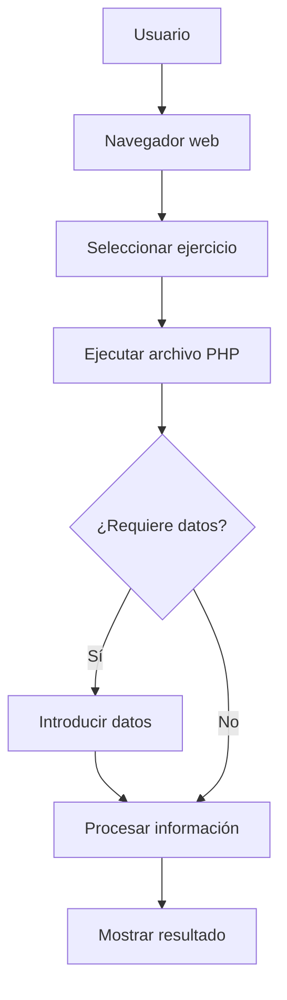

# Practica-1-PHP


## Descripción del proyecto

Este proyecto contiene una carpeta donde están todas las actividades realizadas en la práctica.

A lo largo de los ejercicios se trabajan diferentes conceptos, como el uso de variables, condicionales, bucles, arrays,y trabajar con formularios de HTML mediante post.

## Objetivo
Los principales objetivos de esta práctica son:
- Aprender a declarar y utilizar variables en PHP.
- Utilizar estructuras condicionales y bucles.
- Trabajar con funciones y arrays.
- Crear formularios utilizando HTML.
- Procesar información enviada mediante POST.
- Mostrar información dinámica en una página web.

## Ejercicios de la práctica

En esta práctica se trabajan diferentes conceptos básicos de PHP mediante los siguientes ejercicios:

| Ejercicio | Archivo | Descripción |
|:----------|:--------:|------------:|
| 1 | presentacion.php | Uso de variables |
| 2 | tabla.php | Tabla de multiplicar |
| 3 | alumnos.php | Gestión de notas |
| 4 | registro.html y procesar.php | Formularios |
| 5 | Pendiente | Pendiente de revisar |
| 6 | agenda.php y agenda.html | Agenda de contactos |

## Información importante

> Esta práctica tiene como objetivo aprender los fundamentos
> de PHP mediante ejercicios sencillos y prácticos.


La práctica se realiza utilizando ~~Java~~ **PHP** como lenguaje de programación.

## Ejemplo de código PHP

En PHP utilizamos la instrucción `echo` para
mostrar información por pantalla.

Por ejemplo:

```php
<?php
$nombre = "Carlos";
echo "Hola, " . $nombre;
?>
```
## Tecnologías utilizadas

### PHP

Lenguaje de programación utilizado para desarrollar
la lógica de los ejercicios.

### HTML

Lenguaje de marcado utilizado para crear la estructura
de las páginas y los formularios.

### GitHub

Plataforma utilizada para almacenar el código y
documentar el proyecto mediante Markdown.

## Conceptos aprendidos

Durante esta práctica hemos trabajado:

- Fundamentos de PHP
  - Variables.
  - Operadores.
  - Estructuras condicionales.
  - Bucles.
- Trabajo con datos
  - Arrays.
  - Funciones.
- Formularios HTML
  - Campos de entrada.
  - Envío de información mediante POST.

## Página oficial de PHP

Haz clic en el siguiente logotipo para visitar
la página oficial de PHP:

[](https://www.php.net/)
## Imagen del proyecto

A continuación se muestra el logotipo de PHP,
el lenguaje utilizado para desarrollar los ejercicios
de esta práctica.


## Historial de cambios

En este proyecto se documentan las modificaciones
y mejoras realizadas durante el desarrollo de
los ejercicios de PHP.

Puedes consultar todos los cambios en el
[registro de cambios](CHANGELOG.md).


## Tareas pendientes

A continuación se muestra el estado de las
tareas realizadas durante el desarrollo de
la práctica de PHP.

- [x] Crear el proyecto de PHP.
- [x] Realizar el ejercicio de presentación.
- [x] Crear la tabla de multiplicar.
- [x] Implementar la gestión de notas.
- [x] Crear el formulario de registro.
- [ ] Revisar el ejercicio 5.
- [ ] Comprobar el funcionamiento de la agenda.
- [ ] Realizar pruebas finales de los ejercicios.


## Avisos importantes

> [!NOTE]
> Para ejecutar los ejercicios es necesario disponer
> de un servidor local compatible con PHP,
> como XAMPP.

## Información adicional

Los ejercicios de esta práctica están desarrollados
utilizando PHP[^1], un lenguaje de programación
especialmente utilizado en el desarrollo web.

[^1]: PHP es un lenguaje de programación del lado
    del servidor que permite generar contenido
    dinámico en páginas web.

> [!WARNING]
> Antes de ejecutar los formularios, comprueba
> que el servidor Apache está iniciado y que
> los archivos PHP están ubicados correctamente.

## Preguntas frecuentes (FAQ)

<details>
<summary>¿Qué necesito para ejecutar los ejercicios?</summary>

Es necesario tener instalado un entorno que permita
ejecutar PHP, como **XAMPP**, y utilizar un navegador web.

</details>

<details>
<summary>¿Cómo puedo ejecutar un archivo PHP?</summary>

1. Inicia el servidor Apache desde XAMPP.
2. Guarda los archivos del proyecto en la carpeta `htdocs`.
3. Abre el navegador.
4. Accede al archivo mediante `localhost`.

</details>

<details>
<summary>¿Qué conceptos se trabajan en esta práctica?</summary>

Los principales conceptos son:

- Variables y operadores.
- Estructuras condicionales.
- Bucles.
- Arrays y funciones.
- Formularios HTML.
- Procesamiento de datos mediante POST.

</details>

<details>
<summary>¿Dónde puedo consultar los cambios del proyecto?</summary>

Puedes consultar las modificaciones realizadas
en el archivo [CHANGELOG.md](CHANGELOG.md).

</details>

## Diagrama de funcionamiento

El siguiente diagrama representa el funcionamiento
general de los ejercicios de nuestra práctica de PHP.



## Licencia

Este proyecto está distribuido bajo la
**licencia MIT**.

He elegido esta licencia porque permite utilizar,
modificar y distribuir libremente el código,
siempre que se mantengan los avisos de derechos
de autor y de la licencia.

Considero que es adecuada para una práctica
educativa de PHP, ya que facilita que otros
estudiantes puedan consultar y reutilizar
el código para aprender.

Puedes consultar la licencia completa en
el archivo [LICENSE](LICENSE).
